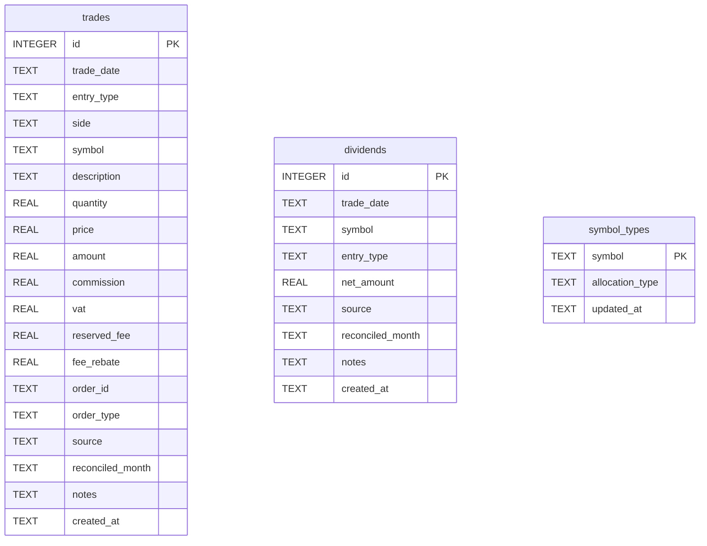

# Data model

Three independent SQLite tables (`data/portfolio.db`, schema defined in
`core/db.py`). No foreign keys between any of them -- a dividend/interest
posting isn't linked back to the specific trade(s) that produced it, and
`symbol_types` links to the others only loosely, by `symbol` string, not a
declared FK.

## `trades`

| Column | Type | Notes |
|---|---|---|
| `id` | INTEGER PK | autoincrement |
| `trade_date` | TEXT | ISO `YYYY-MM-DD` |
| `entry_type` | TEXT | default `'Trade Entry'`; also `'Stock Split'`, `'ReOrg CA'`, or blank (seeded rights-distribution rows) |
| `side` | TEXT | `'buy'` \| `'sell'` \| NULL (corporate-action rows have no side) |
| `symbol` | TEXT NOT NULL | |
| `description` | TEXT | free text, often blank |
| `quantity` | REAL NOT NULL | **signed**: positive = buy, negative = sell |
| `price` | REAL | nullable -- e.g. a rights-offering distribution has no price |
| `amount` | REAL | **signed** gross value = quantity × price, negated for a buy (cash out), positive for a sell (cash in). Does **not** include commission. |
| `commission` | REAL | net fee total, see `db.compute_net_commission()` |
| `vat`, `reserved_fee`, `fee_rebate` | REAL | the raw components that get netted into `commission` at insert time |
| `order_id`, `order_type` | TEXT | from the broker slip, if available |
| `source` | TEXT NOT NULL | `'seed'` (imported from xlsx) \| `'manual'` \| `'slip'` |
| `reconciled_month` | TEXT | NULL until Reconciliation confirms this row against an xlsx statement; then the `'YYYY-MM'` of the statement it matched |
| `notes` | TEXT | |
| `created_at` | TEXT NOT NULL | `datetime('now')` at insert time |

## `dividends`

| Column | Type | Notes |
|---|---|---|
| `id` | INTEGER PK | autoincrement |
| `trade_date` | TEXT NOT NULL | ISO `YYYY-MM-DD` |
| `symbol` | TEXT | NULL for Interest rows (matches the xlsx seed convention) |
| `entry_type` | TEXT NOT NULL | CHECK constrained: `'Dividend'` \| `'Interest'` \| `'Capital Distribution'` |
| `net_amount` | REAL NOT NULL | gross minus withholding tax, computed at save time on Record Dividend |
| `source` | TEXT NOT NULL | `'seed'` \| `'manual'` |
| `reconciled_month` | TEXT | same semantics as `trades.reconciled_month` |
| `notes` | TEXT | |
| `created_at` | TEXT NOT NULL | |

## `symbol_types`

| Column | Type | Notes |
|---|---|---|
| `symbol` | TEXT PK | one row per symbol, not per trade |
| `allocation_type` | TEXT NOT NULL | CHECK constrained: `'Dividend'` \| `'Growth'` -- **`'Others'` is deliberately not a valid stored value** |
| `updated_at` | TEXT NOT NULL | `datetime('now')`, refreshed on every upsert |

A symbol with **no row at all** here means "Others" -- the default for
anything not yet actively classified, guaranteed at fetch time by
`db.fetch_symbol_types()` (starts from every distinct symbol in `trades`,
left-joins this table, fills missing with `"Others"`) rather than by
writing a row for every symbol. This mirrors `reconciled_month IS NULL`
meaning "not yet reconciled" elsewhere in this schema: absence of a row is
the default state, not a stored sentinel. Keeps the table itself small
(only symbols someone has actively tagged) while every caller (Allocation
Type page, Dashboard, a future rebalance planner) still sees a complete,
always-classified view. See `docs/METHODOLOGY.md` for how a symbol gets
tagged (bulk catch-up vs. first-trade inline field) and `docs/ROADMAP.md`'s
V2.1 section for the full design reasoning.

## `option_trades` (V4.22)

A dedicated table for option trades -- deliberately **not** a reuse of `trades`'
FIFO position pipeline, which assumes a symbol's first trade is always a buy
establishing cost basis before a sell realizes against it. That assumption is
wrong for a short options strategy (selling to open before buying to close); see
`core/option_pl.py`'s own module docstring for the real bug this would cause if
option trades were ever entered through `trades` instead.

| Column | Type | Notes |
|---|---|---|
| `id` | INTEGER PK | autoincrement |
| `trade_date` | TEXT NOT NULL | ISO `YYYY-MM-DD` |
| `symbol` | TEXT NOT NULL | OCC-style compound ticker, e.g. `"MNST261218C00045000"` (see `core/options.py`) |
| `underlying`, `option_type`, `strike`, `expiration_date` | -- | the same contract, decomposed -- so callers never have to re-parse `symbol` |
| `side` | TEXT NOT NULL | `'buy'` \| `'sell'` -- determines `amount`'s sign, same as `trades.side` |
| `position_effect` | TEXT NOT NULL | `'open'` \| `'close'` -- the field that makes matching direction-agnostic; never inferred from `side` |
| `contracts` | REAL NOT NULL | always a **positive** magnitude (1 contract = 100 shares); direction comes from `side` + `position_effect` together, not from this column's sign |
| `price` | REAL NOT NULL | quoted per-contract premium |
| `amount` | REAL NOT NULL | net signed cash flow AFTER every fee below: buy = negative (money out), sell = positive (money in) |
| `commission`, `vat`, `occ_fee`, `orf_fee`, `taf_fee`, `sec_fee` | REAL | the six fee line items a real Dime! "Order Information" screen shows -- verified exactly against two real screenshots (buy: 180.00 + 0.55 + 0.04 + 0.03 + 0.02 = 180.64 Total Cost; sell: 235.00 − 0.55 − 0.04 − 0.03 − 0.02 − 0.00 − 0.01 = 234.35 Estimated Total Credit) |
| `source` | TEXT NOT NULL | `'manual'` \| `'slip'` \| `'migrated-seed'` (the 6 historical option trades originally seeded into `trades`, copied here -- `trades` itself is untouched) |
| `notes` | TEXT | |
| `created_at` | TEXT NOT NULL | |

No `reconciled_month` -- Reconciliation doesn't cover option trades (out of scope
for V1). `core/option_pl.py::match_round_trips` does the actual FIFO lot-matching
at READ time (nothing here is pre-matched/stored) -- see that module's docstring
for the partial-fill mechanics.

## Mapping to the official xlsx

The xlsx (`data/Offshore_Statements_*.xlsx`) is the audited source of
truth; SQLite is where live activity gets logged between statements and
where the seeded historical copy lives. Column names and vocabulary
**don't** line up 1:1 -- both `scripts/seed_from_xlsx.py` (the one-time
importer) and `core/reconciliation.py` (the ongoing matcher) have to bridge
the gap:

| xlsx sheet | xlsx columns | SQLite table | Note |
|---|---|---|---|
| `Transactions` | Trade Date, Entry Type, Side, Symbol, Description, Quantity, Price, Amount, Commission | `trades` | Only rows with `Symbol` non-null become trade rows -- journal/cash rows in `Transactions` are skipped |
| `Income` (`Dividends` + `Div. Adj(NRA Withheld)` rows) | Trade Date, Symbol, Net Amt | `dividends` (`entry_type='Dividend'`) | The two xlsx rows per real dividend are **grouped and summed** by `(Trade Date, Symbol)` into one SQLite row |
| `Income` (`Credit/Margin Interest` rows) | Trade Date, Net Amt (Symbol present but discarded) | `dividends` (`entry_type='Interest'`, `symbol=NULL`) | The real xlsx Symbol (e.g. `SHV`) is intentionally dropped -- see `docs/ROADMAP.md`'s V2 research notes for why this was a deliberate, verified decision, not an oversight |

Full vocabulary-difference reasoning (why matching/blending never keys on
`entry_type` across the xlsx/SQLite boundary) lives in
`docs/METHODOLOGY.md` and `docs/ROADMAP.md` (V2 section) -- not repeated
here to avoid the two documents drifting out of sync.
